## System Architecture

```mermaid
flowchart TB
    %% =========================
    %% PRESENTATION LAYER
    %% =========================
    subgraph UI["Presentation Layer — Streamlit Frontend"]
        direction TB
        Browser["User Browser UI<br/>Symptom Input · GPS Button<br/>Tabs · Video and Clinic Rendering"]
        Map["Folium Map Component<br/>folium · streamlit-folium<br/>User Location + Clinic Markers"]
    end

    %% =========================
    %% APPLICATION LAYER
    %% =========================
    subgraph APP["Application Layer — Streamlit Server (Python 3.11)"]
        direction TB

        Session["Session State<br/>st.session_state<br/>cached_keywords<br/>cached_medical_keywords<br/>cached_videos · cached_clinics"]

        Validation["Symptom Validation<br/>spaCy NER<br/>en_ner_bc5cdr_md"]

        Orchestrator["Request Orchestration<br/>Routing · Cache Lookup<br/>Result Coordination"]

        YouTubeExtractor["YouTubeExtractor<br/>Search · Statistics · Scoring<br/>Top 10 Video Selection"]

        NearbyMedicalFinder["NearbyMedicalFinder<br/>Candidate Filtering · Deduplication<br/>Distance · Relevance Ranking<br/>Top 15 Clinic Selection"]

        CacheResource["Resource Cache<br/>@st.cache_resource<br/>Reusable Heavy Objects"]
    end

    %% =========================
    %% AI / ML SERVICES
    %% =========================
    subgraph AI["AI / NLP Layer"]
        direction TB
        Gemini["Gemini LLM Service<br/>Gemini 2.5 Flash<br/>google.generativeai"]
        Transformer["Sentence-Transformer<br/>all-MiniLM-L6-v2<br/>sentence_transformers<br/>Embeddings + Cosine Similarity"]
    end

    %% =========================
    %% EXTERNAL APIS
    %% =========================
    subgraph EXT["External APIs"]
        direction TB
        YouTubeAPI["YouTube Data API v3<br/>googleapiclient.discovery<br/>Video Search + Statistics"]
        PlacesAPI["Google Places API<br/>searchText + searchNearby<br/>Clinic Candidate Retrieval"]
    end

    %% USER INPUT AND VALIDATION
    Browser -->|"Symptom description"| Orchestrator
    Orchestrator -->|"Check medical entities"| Validation
    Validation -->|"No medical entity: show validation message"| Browser
    Validation -->|"Valid symptom input"| Orchestrator

    %% SESSION STATE AND RESOURCE CACHING
    Orchestrator <-->|"Read / update query results"| Session
    CacheResource -.->|"Loaded spaCy model"| Validation
    CacheResource -.->|"Loaded Gemini client"| Gemini
    CacheResource -.->|"Loaded Places client, if applicable"| PlacesAPI

    %% KEYWORD EXTRACTION
    Orchestrator -->|"Valid symptoms; extract keywords"| Gemini
    Gemini -->|"YouTube keywords + medical keywords"| Orchestrator
    Orchestrator -->|"Cache extracted keywords"| Session

    %% YOUTUBE RECOMMENDATION PIPELINE
    Orchestrator -->|"YouTube keywords"| YouTubeExtractor
    YouTubeExtractor -->|"Search videos / fetch statistics"| YouTubeAPI
    YouTubeAPI -->|"Video metadata, views and likes"| YouTubeExtractor
    YouTubeExtractor -->|"Score = views + 2 × likes; select top 10"| Orchestrator
    Orchestrator -->|"Cache top 10 videos"| Session
    Session -->|"Video results"| Browser

    %% CLINIC RECOMMENDATION PIPELINE
    Orchestrator -->|"Medical keywords + symptom text + user coordinates"| NearbyMedicalFinder
    NearbyMedicalFinder -->|"Search clinic candidates"| PlacesAPI
    PlacesAPI -->|"Place details and coordinates"| NearbyMedicalFinder

    NearbyMedicalFinder -->|"Encode symptom query and clinic descriptions"| Transformer
    Transformer -->|"Embeddings for similarity calculation"| NearbyMedicalFinder

    NearbyMedicalFinder -->|"Filter rating ≥ 2; deduplicate; calculate Haversine distance; rank by distance and relevance"| NearbyMedicalFinder
    NearbyMedicalFinder -->|"Top 15 ranked clinics"| Orchestrator
    Orchestrator -->|"Cache clinic results"| Session

    %% UI RENDERING
    Session -->|"Clinic results"| Browser
    Session -->|"Clinic coordinates + user location"| Map
    Map -->|"Rendered interactive map"| Browser

    %% GPS FLOW
    Browser -->|"Request device location"| Browser

    %% STYLING
    classDef frontend fill:#16324F,stroke:#61A5C2,color:#FFFFFF,stroke-width:1.5px
    classDef backend fill:#342A1E,stroke:#D6B56D,color:#FFFFFF,stroke-width:1.5px
    classDef ai fill:#382641,stroke:#C792D8,color:#FFFFFF,stroke-width:1.5px
    classDef external fill:#1E2C43,stroke:#7FA8E8,color:#FFFFFF,stroke-width:1.5px

    class Browser,Map frontend
    class Session,Validation,Orchestrator,YouTubeExtractor,NearbyMedicalFinder,CacheResource backend
    class Gemini,Transformer ai
    class YouTubeAPI,PlacesAPI external
```

### Key Design Notes

- **Symptom validation:** spaCy's `en_ner_bc5cdr_md` checks for medical entities before downstream API requests.
- **Keyword extraction:** Gemini produces separate YouTube-search and medical-keyword sets.
- **YouTube ranking:** Videos are scored using `views + 2 × likes`, and the top 10 are selected.
- **Clinic ranking:** Candidate clinics are filtered, deduplicated, and ranked using distance and relevance signals, including rating, keyword boost, and semantic similarity.
- **Session caching:** Previously computed results can be reused for identical queries within the relevant session.
- **Resource caching:** `@st.cache_resource` reuses heavyweight objects rather than reloading them on every rerun.
- **Map rendering:** Folium visualizes clinic markers and the user's location; it does not perform clinic discovery or ranking.
